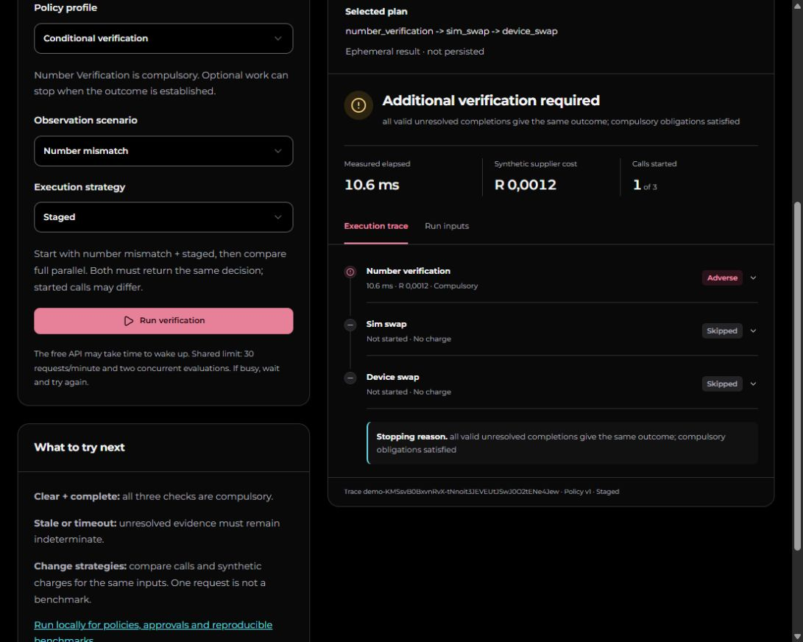

# Open-source release and public sandbox

Recorded 2026-10-25. The user explicitly approved public source, public testing and
the MIT license. The [repository](https://github.com/bandilleee/OptiTrace) is PUBLIC
and anonymously readable. GitHub identifies its license as MIT. Private vulnerability
reporting is enabled. The homepage links to the public sandbox.

## Public experience

[Try OptiTrace](https://optitrace.vercel.app/demo) without Google sign-in or an
invitation. Visitors select a fixed synthetic profile/scenario/strategy, invoke the
actual Go evaluator, inspect evidence and export JSON. No client-side substitute
decides the outcome. Default staged/number-mismatch demonstrates safe stopping;
users can compare full parallel, sequential, OPA and OptiTrace strategies.

Results are ephemeral and explicitly not persisted. There is no public tenant,
shared administrator account, invitation acceptance bypass, policy approval bypass
or benchmark submission. The existing console remains invitation-only. Full local
setup is documented for exploring the rest of the application.

The endpoint is opt-in, accepts at most 2048 bytes, allows two concurrent evaluations
and 30 requests/minute per process, with a five-second evaluation deadline. Unknown
fields and arbitrary policies/tenant IDs are rejected. See the reviewed
[public boundary contract](../../contracts/PUBLIC-DEMO.md) and OpenAPI operation.

## Source and deployment

- API implementation: `4eebebf63932ab3b21df3f4f2172921b52be99be`.
- Final UI/input-clearing fix: `75f784a0981f8c34e2d6344c085dc7bf3ab0b345`.
- Render live deploy: `dep-dbf0ct7avr4c73cccjd0`, existing Free service; only
  `PUBLIC_DEMO_ENABLED=true` added to its configuration.
- Vercel READY production deploy: `dpl_9DrF61QM6YzXtwQoFYQ5srbUY5q2`, existing
  Hobby project, canonical `/demo` returns HTTP 200 anonymously.
- No new paid resources, new production credentials, provider access grants or
  billing-setting changes. Existing tenant permissions are unchanged.

## Validation observed

| Check | Result |
|---|---|
| Gitleaks full Git history before publication | PASS, 43 commits, no leaks; redacted report private under ignored `.artifacts/release/` |
| Tracked content/proposal review | Synthetic concept proposal, fixtures and engineering evidence reviewed; no customer dataset or hosted secrets identified; `Context/` preserved |
| Native server tests with disposable PostgreSQL and both auth test URLs | PASS, exit 0, 2.015 s |
| Public demo regression suite after tenant-boundary test added | PASS, exit 0, 0.282 s; vet exit 0 |
| Linux public-demo race tests | PASS, exit 0, 1.229 s |
| Web typecheck, format, 15 unit tests, production build | PASS; final UI fix typecheck/format passed and Vercel build READY |
| Generated OpenAPI client drift | PASS, exit 0 |
| Browser tests against local production build | PASS, 2/2; initial ambiguous test selectors corrected, not a claimed application repair |
| Final browser tests against hosted page | PASS, 2/2, 15.4 s: anonymous entry, request contract, expandable evidence, JSON export, input-change clearing, mobile width and capacity error; evaluation responses intercepted as fixtures for these UI tests |
| Actual unauthenticated hosted Go requests | PASS; three real engine responses, no cookies/keys; [safe results](public-demo-hosted.json) |
| Actual hosted browser request | PASS; staged number mismatch returned additional verification, one compulsory call, two skipped, charge 1,200 microrand; saved screenshot below |
| Public input and tenant boundaries | Tenant input rejected 400; unauthenticated tenant evaluations GET rejected 401 |
| Hosted persistence after public requests | Still 3 tenant evaluations, 18 journal events, 1 benchmark job, zero `demo-` resources |

Actual hosted outcomes: complete/clear/OptiTrace `verified`, three calls; conditional/
number-mismatch/staged `additional_verification_required`, one call; conditional/
stale/OptiTrace `indeterminate`, three calls. Started charges equal the sum of check
charges. No tenant identifier occurs in public results. These are synthetic
functional examples, not full-API p95 or commercial savings evidence.

## Remaining limits

The post-publication GitHub run
[40198892815](https://github.com/bandilleee/OptiTrace/actions/runs/40198892815)
failed before executing jobs. Its annotation states: "The job was not started
because your account is locked due to a billing issue." Making the repository
public did not remove the account-level restriction. Hosted CI is unverified;
local tests and provider builds do not replace it.

The [full acceptance HOLD](NEXT-PHASE.md), controlled performance work, independent
acceptance, hosted restore and rollback drills remain open. The sandbox does not
claim to complete those gates. Shared limits can be exhausted by other visitors;
free services can sleep. Disable the demo flag and redeploy to remove public
evaluation access. No automatic keep-awake requests were added.

Original license notices for bundled Montserrat fonts are included; dependencies
and third-party marks retain their own licenses/rights. User-provided untracked
`artifacts/` was neither staged nor modified. Temporary test PostgreSQL was stopped
with its data retained.
